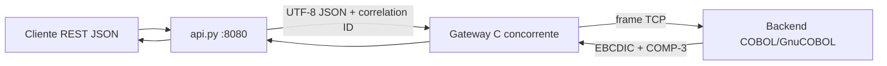
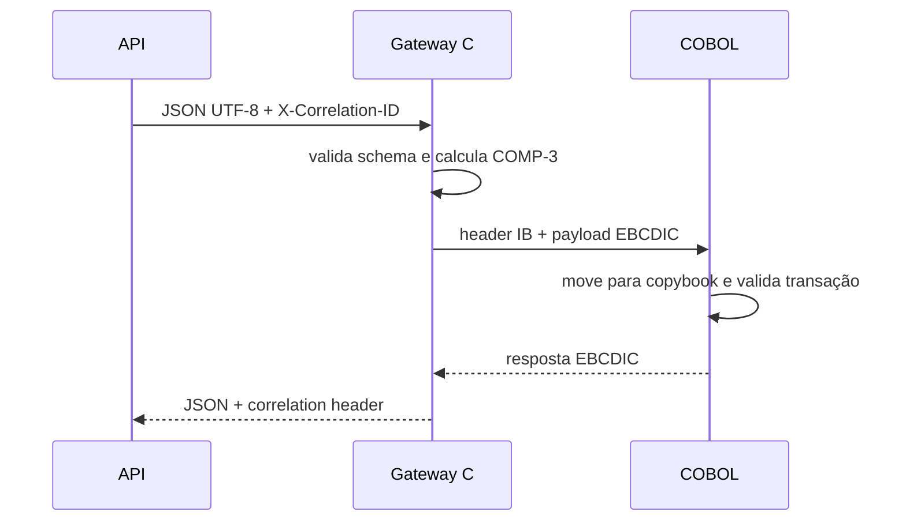

# IronBridge-390 — arquitetura

## Fluxo executável

## Contrato binário

## Produção versus laboratório

O laboratório usa `cobol_socket_shim.c` para disponibilizar sockets POSIX ao
GnuCOBOL. Em z/OS, esse ponto é substituído por CICS TCP/IP, `EZASMI` ou um
monitor de transação; o copybook e o contrato de 42 bytes permanecem iguais.
