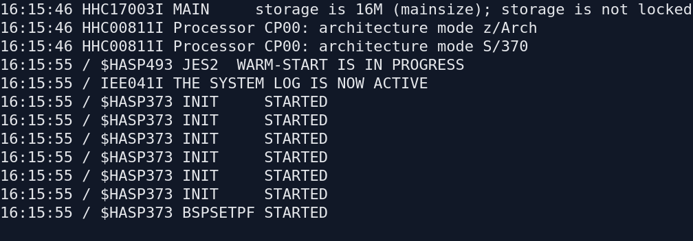
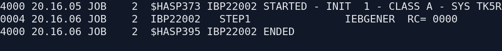
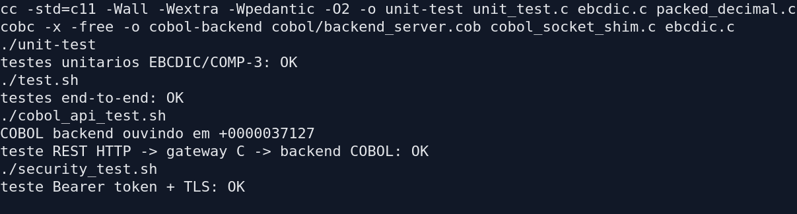
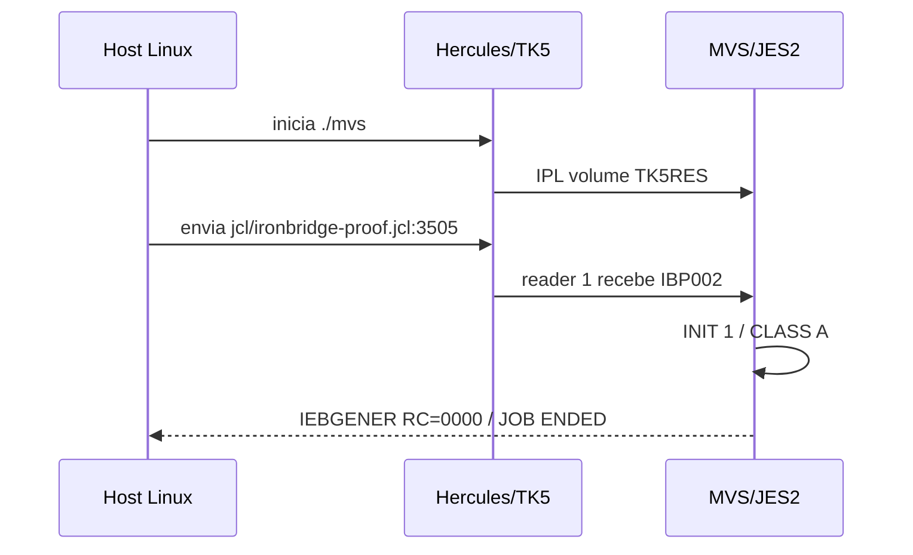

# Evidências de execução

## IPL do MVS 3.8J

O guest iniciou o IPL, ativou o system log e colocou o JES2 em warm-start.

## Job JCL executado dentro do MVS

O job foi enviado pelo reader TCP `3505`, executado pelo initiator de classe A
e finalizado com `IEBGENER RC=0000`.

## Suíte do projeto

## Limite importante

Esta prova executa um job JCL dentro do MVS 3.8J. O backend COBOL de negócio
do IronBridge continua sendo executado via GnuCOBOL no host; para executá-lo
dentro do guest seria necessário compilá-lo com um compilador COBOL disponível
no MVS e transferir o load module para um dataset do guest.
