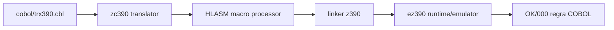

# Evidência da compilação COBOL mainframe com zCOBOL

O teste foi executado com Java 26 e z390 V1.8.05, usando a fonte
`cobol/trx390.cbl`. O nome curto é necessário porque o linker histórico do
z390 usa nomes de programa de até oito caracteres.

```text
ZC390 START USING z390 V1.8.05
ZC390 ENDED   RC= 0
MZ390 ENDED   RC= 0
LZ390 ENDED   RC= 0
 OK / 000   Transacao validada pelo core legado
EZ390 ENDED   RC= 0
teste zCOBOL/z390: OK
```

Fluxo comprovado:



Essa prova é complementar ao `make hercules-jcl-check`: z390 prova a
toolchain e a execução do programa COBOL; TK5 prova IPL, JES2 e execução de
JCL no guest MVS.
