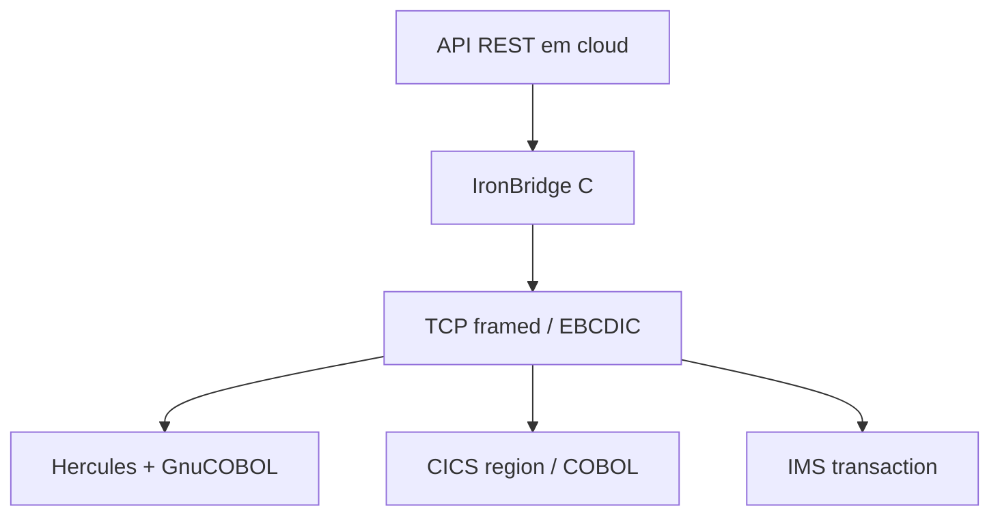

# Adaptação CICS, IMS e Hercules



O laboratório reproduz o contrato usando GnuCOBOL. Para z/OS, o programa
`IRONBRIDGE-COBOL-BACKEND` vira uma transação CICS ou um programa chamado por
IMS. A camada de transporte muda; os campos `PIC X`, `COMP-3`, offsets e
regras de validação são os mesmos.

## JCL conceitual

```jcl
//IBCOB    JOB (IRON),'IRONBRIDGE',CLASS=A,MSGCLASS=X
//COMPILE  EXEC IGYWCLG
//COBOL.SYSIN DD DSN=IRONBRIDGE.SOURCE(BACKEND),DISP=SHR
//LKED.SYSLMOD DD DSN=IRONBRIDGE.LOAD(BACKEND),DISP=SHR
//RUN      EXEC PGM=IRONBRIDGE,REGION=0M
//STEPLIB  DD DSN=IRONBRIDGE.LOAD,DISP=SHR
//SYSOUT   DD SYSOUT=*
```

Esse JCL é um contrato de implantação e precisa ser ajustado aos nomes das
bibliotecas, CICS/IMS e políticas de segurança do ambiente real.
