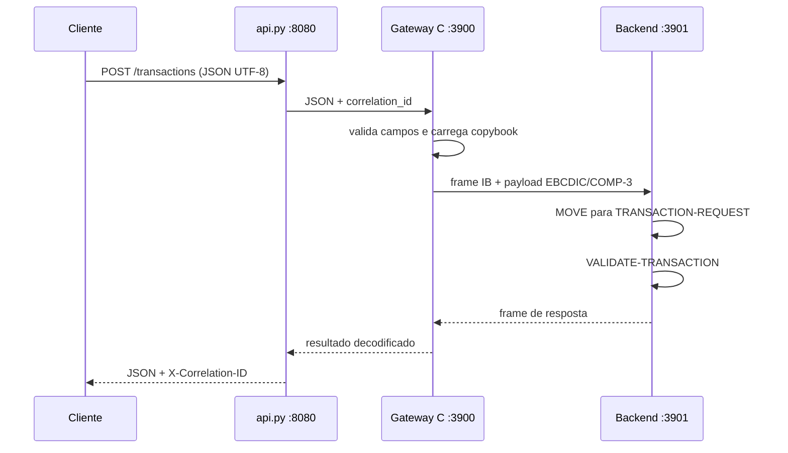

# Guia técnico do IronBridge-390

Este documento explica o projeto do ponto de vista de quem precisa operar ou
alterar a solução. O README é o caminho rápido; aqui estão as decisões, os
dados que atravessam cada fronteira e as limitações que ainda dependem de um
ambiente IBM licenciado.

## Qual problema o projeto resolve

Sistemas legados normalmente não recebem JSON. Um programa COBOL espera um
registro de tamanho fixo, com texto em EBCDIC e números monetários em
`COMP-3`. O IronBridge coloca uma fronteira controlada entre os dois mundos:

1. a API recebe JSON/UTF-8;
2. o gateway C valida os campos e monta o registro legado;
3. o gateway converte texto para EBCDIC Code Page 037 e dinheiro para packed
   decimal;
4. o backend COBOL aplica a regra de negócio;
5. a resposta faz o caminho inverso e volta como JSON.

O objetivo é demonstrar uma integração realista, não fingir que um emulador
de CPU é um ambiente z/OS. O código pode ser executado localmente com o
emulador C, com GnuCOBOL ou com o guest MVS do Hercules, cada um validando uma
parte diferente do contrato.

## Componentes

| Componente | Função | Execução |
|---|---|---|
| `api.py` | HTTP, JSON, autenticação Bearer, TLS opcional, métricas e idempotência | Linux/Python |
| `ironbridge` | Gateway concorrente, framing TCP, validação e conversões | Linux/C |
| `backend-emulator` | Substituto rápido do core COBOL para testes | Linux/C |
| `cobol-backend` | Mesmo contrato implementado em COBOL | GnuCOBOL/Linux |
| `hercules/mvs-tk5` | Guest MVS 3.8J para IPL, JES2 e JCL | Hercules |
| `copybook_parser.c` | Lê o subconjunto de copybook suportado e calcula layout | Linux/C |

O emulador C e o programa COBOL não são chamados simultaneamente. Escolhe-se
um backend na porta 3901; o gateway não precisa saber qual implementação está
atrás do socket.

## Caminho de uma requisição

O caminho REST completo é:



Uma falha em cada fronteira tem significado diferente. JSON inválido é erro
de entrada; backend indisponível é erro de infraestrutura; valor zero,
moeda desconhecida ou operação inválida são rejeições da regra COBOL e
retornam `ER/422`.

## Registro legado e copybook

O copybook de entrada possui 42 bytes:

| Campo | Formato | Tamanho | Offset |
|---|---|---:|---:|
| `TRX-ID` | `PIC X(16)` | 16 | 0 |
| `ACCOUNT-ID` | `PIC X(12)` | 12 | 16 |
| `AMOUNT` | `PIC 9(9)V99 COMP-3` | 6 | 28 |
| `CURRENCY-CODE` | `PIC X(3)` | 3 | 34 |
| `OPERATION` | `PIC X(5)` | 5 | 37 |

O `COMP-3` guarda dois dígitos por byte e reserva o nibble final para o
sinal. Assim, `125.37` vira 12.537 centavos e é empacotado como 6 bytes; não
há `float` atravessando o contrato legado.

O parser de copybook calcula os offsets e tamanhos físicos em vez de exigir
que o comando de inspeção conheça esses números. Use:

```bash
make schema
./copybook-inspect copybook.cpy
```

O gateway rejeita no startup um copybook cujo tamanho final não seja 42 bytes.
Isso evita iniciar um serviço que produziria registros incompatíveis.

Quando os nomes do copybook forem diferentes, o quinto argumento opcional do
gateway recebe um arquivo de mapeamento:

```bash
./ironbridge 3900 127.0.0.1 3901 copybook-alias.cpy copybook-alias.map
```

O mapeamento altera nomes, mas não libera tamanhos ou offsets incompatíveis:
o registro físico continua precisando ter 42 bytes para conversar com este
backend.

## O que o parser suporta

O parser agora aceita linhas de dados com níveis COBOL, ponto final, espaços
entre `PIC` e a cláusula, comentários `*>`, `PIC X(n)`, `PIC 9(n)`, repetição
de dígitos (`999V99`), escala `V`, sinal `S` e `COMP-3` em qualquer combinação
de maiúsculas/minúsculas. Grupos sem `PIC` são ignorados; somente itens
elementares entram no layout.

Isso é um parser de layout, não um compilador COBOL. Ele não interpreta
`REDEFINES`, `OCCURS`, grupos aninhados com expansão, `SIGN SEPARATE`,
`COMP-1`, `COMP-2`, `COMP-4`, `COMP-5`, edição monetária ou cláusulas de
justificação. Para esses casos, o comando falha ou deve receber um copybook
reduzido para a interface, em vez de inventar um offset.

Também é importante distinguir duas coisas: o parser tornou o schema
configurável e verificável, mas o contrato desta API continua tendo cinco
campos semânticos. Uma futura versão que aceite qualquer copybook precisará de
um mapeamento por nome/tipo para o JSON; trocar apenas o parser não basta.

## Como executar

Terminal 1, backend C:

```bash
make
./backend-emulator 3901
```

Terminal 2, gateway e cliente:

```bash
./ironbridge 3900 127.0.0.1 3901 copybook.cpy
python3 client.py --port 3900 \
  --transaction-id TRX000000000001 --account-id 123456789012 \
  --amount 125.37 --currency BRL --operation DEBIT
```

Para usar o COBOL real, substitua o backend C:

```bash
make cobol-backend
./cobol-backend 3901
./ironbridge 3900 127.0.0.1 3901 copybook.cpy
```

Para o caminho HTTP:

```bash
python3 api.py --port 8080 --gateway-port 3900
curl -X POST http://127.0.0.1:8080/transactions \
  -H 'Content-Type: application/json' \
  -d '{"transaction_id":"TRX000000000001","account_id":"123456789012","amount":"125.37","currency":"BRL","operation":"DEBIT"}'
```

## Como testar e o que cada teste prova

```bash
make test                 # unitário + gateway + COBOL + Bearer/TLS
make hardening-test       # fragmentação, limites HTTP, readiness e aliases
make asan-test            # sanitizers de memória e comportamento indefinido
make api-test             # API REST com backend C
make load-test            # API já iniciada; mede concorrência
make hercules-check       # somente configuração do Hercules
make hercules-mvs-check   # IPL real do MVS TK5
make hercules-jcl-check   # job enviado ao JES2 pelo reader TCP
```

O teste de Hercules não substitui o teste de negócio: ele prova que o guest
inicia, que o JES2 aceita um job e que `IEBGENER` termina com `RC=0000`. A
prova do backend COBOL é `make cobol-api-test`, que percorre REST, gateway,
EBCDIC/COMP-3 e GnuCOBOL.

## Segurança e operação

O modo local pode ser simples. Para demonstrar controles adicionais:

```bash
IRONBRIDGE_API_TOKEN=dev-secret python3 api.py --port 8080
python3 api.py --tls-cert cert.pem --tls-key key.pem
curl http://127.0.0.1:8080/health
curl http://127.0.0.1:8080/metrics
```

`/health` indica que o processo HTTP está vivo; `/ready` verifica também se o
gateway pode aceitar conexões. Para evitar reprocessamento durante retries, inicie a API com `--db` e envie
`Idempotency-Key`. O mesmo payload recebe a resposta armazenada; a mesma chave
com outro payload recebe `409`.

Em produção, TLS deve terminar em um proxy ou ser configurado com certificados
gerenciados; o exemplo local usa apenas a biblioteca padrão do Python. O
gateway registra `correlation_id`, `transaction_id` e status em JSON no
`stderr`, facilitando correlacionar uma chamada HTTP com o processamento
legado.

## Limite MVS/z/OS explicado corretamente

O TK5 fornecido para Hercules é MVS 3.8J. Ele é um sistema operacional IBM
histórico, útil para provar IPL, JES2, datasets e JCL; não é z/OS moderno. O
Hercules também não inclui, por si só, um compilador IBM COBOL.

Por isso o projeto tem duas provas separadas:

- `make cobol-api-test`: executa a regra COBOL real com GnuCOBOL no Linux;
- `make hercules-jcl-check`: executa um job JCL dentro do MVS 3.8J.

Para executar o mesmo programa COBOL dentro do guest seria necessário obter
um compilador COBOL compatível com S/370/MVS ou um load module já compilado,
transferi-lo para um dataset e ajustar JCL, bibliotecas e I/O. Um executável
GnuCOBOL ELF do Linux não pode ser copiado para o MVS e executado. Essa etapa
depende de uma toolchain/licença externa e não deve ser apresentada como
concluída apenas porque o IPL funcionou.

As evidências capturadas estão em
[docs/evidence/mvs-execution.md](evidence/mvs-execution.md). Elas mostram
exatamente o que foi executado e onde.
