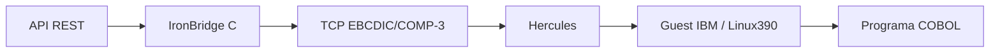

# Hercules local

O Hercules é o emulador do processador/dispositivos IBM; ele não inclui um
z/OS ou uma imagem de disco licenciada. O arquivo `ironbridge.cnf` fornece um
perfil mínimo para validar a instalação e o ambiente do emulador.

Verificar a instalação:

```bash
hercules --help
timeout 3 hercules -f hercules/ironbridge.cnf -n
```

Ou pelo Makefile:

```bash
make hercules-check
```

Com a imagem TK5 extraída, valide um IPL real do MVS 3.8J:

```bash
make hercules-mvs-check
```

O teste inicia o Hercules que acompanha o TK5, espera mensagens de boot do
MVS/JES2 e encerra o emulador. As imagens permanecem fora do Git por causa do
tamanho; o diretório é ignorado em `.gitignore`.

Para enviar e executar um job JCL automaticamente:

```bash
make hercules-jcl-check
```

O job [ironbridge-proof.jcl](../jcl/ironbridge-proof.jcl) pode ser enviado ao
reader TCP do TK5 na porta `3505`. Ele executa `IEBGENER` dentro do MVS e deixa
uma saída identificável no spool/printer, servindo como prova de execução do
guest.

Para conectar um sistema operacional real, é necessário obter uma imagem de
Hercules/z/OS ou Linux/390 compatível e acrescentar os dispositivos `dasd`,
`3270` e `tape` ao `.cnf`. O backend COBOL do projeto continua sendo executável
diretamente com GnuCOBOL enquanto essa imagem não estiver configurada.


